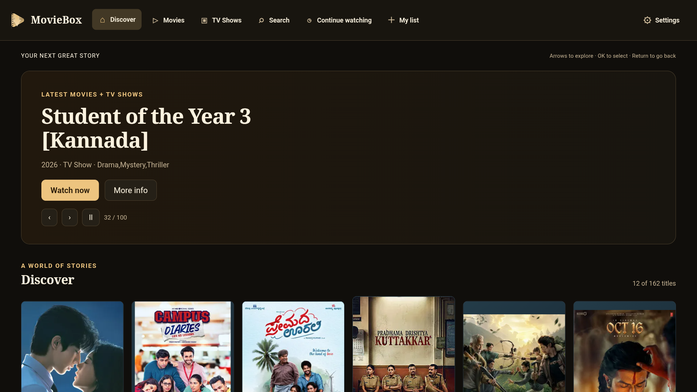
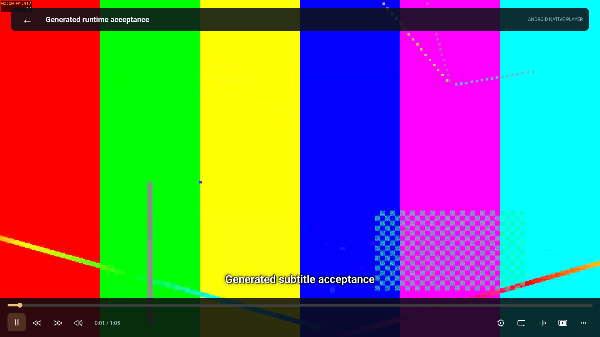

# MovieBox Android TV App

**A remote-first Android TV / Google TV client with the shared MovieBox TV interface and native Media3 playback.**

[](https://github.com/emransm877/moviebox-android-tv/actions/workflows/checks.yml)
[](https://github.com/emransm877/moviebox-android-tv/releases/latest)

[Project website](https://emransm877.github.io/moviebox-projects/) · [Installation](docs/INSTALLATION.md) · [Validation](docs/VALIDATION.md) · [Report an issue](https://github.com/emransm877/moviebox-android-tv/issues)

An independent community client. The installed app is named **MovieBox**.
This is separate from the Android phone patch, Windows application and Samsung
Tizen widget. It is not an official MovieBox release.



## Download and install

| File | Version | Use |
| --- | --- | --- |
| [Android TV APK](https://github.com/emransm877/moviebox-android-tv/releases/download/v0.1.0/MovieBox-Android-TV-0.1.0.apk) | 0.1.0 | Signed, non-debuggable APK for Android TV / Google TV |
| [SHA-256 checksum](https://github.com/emransm877/moviebox-android-tv/releases/download/v0.1.0/MovieBox-Android-TV-0.1.0.apk.sha256) | 0.1.0 | Verify the exact downloaded file |

Transfer the APK to your TV, allow installation from your chosen file manager,
then open it. MovieBox appears in the TV launcher. A PC can also install it using
`adb install -r MovieBox-Android-TV-0.1.0.apk` after enabling the TV's developer
connection. Read the [installation and update guide](docs/INSTALLATION.md).

- Android TV / Google TV; minimum Android 6.0 (API 23), with a current Android
  System WebView provider. Older OS/WebView combinations are not individually
  validated. Source targets SDK 35 and compiles with SDK 36.
- Java-based universal APK; no architecture-specific application native libraries.
- Internet access and supported device codecs are required for service playback.
- Samsung Tizen TVs require the [separate Samsung app](https://github.com/emransm877/moviebox-tizen).
- No Google Play listing or universal device-compatibility certification is claimed.

## Features

- Shared TV home, title-specific artwork, featured carousel, Movies and TV Shows.
- Desktop theme palettes: Obsidian, Orbital, Prism, Aurora and Eclipse.
- Remote arrows, OK and Back; native Android search keyboard.
- Native Media3 fullscreen video behind the shared HTML controls.
- Available quality and embedded-audio choices; safe separate alternate editions.
- Automatic service-provided subtitles, local subtitle caching and timing controls.
- My list, per-episode progress, resume and atomic Android-private storage.
- In-player seasons/episodes; Up opens the drawer only when controls are hidden.
- Series autoplay to the next actual available episode; final return to details.
- Bounded source recovery and responsive Back navigation after playback failure.
- Optional GitHub release notices with Later, Skip and opt-out. A source commit
  alone is not an app update; installation is always a user action.



*Actual runtime capture with generated media. Catalogue artwork belongs to its
respective owners. A screenshot does not certify every device or source.*

## Known limits

This first independent preview is not complete desktop/phone feature parity.
Background-download management, local-video/file-picker integration and account
flows still need platform work. Android WebView, codecs, remotes and TV models
vary. The app cannot guarantee 1080p, subtitles or languages absent upstream.
Progressive MP4 quality changes are not seamless adaptive streaming. Alternate
editions with different runtimes start separately rather than reusing timestamps.

No membership, DRM or service-access bypass is included. Locked resources and
placeholder media are excluded. Live-service availability may change.

## Validation and release identity

The exact signed release APK was installed and exercised with native decoding,
Android key events, seeking, subtitles, embedded audio, sparse episode autoplay,
failed-source exit, navigation away during playback and cold-process persistence.
See the [test target, evidence and limits](docs/VALIDATION.md). Physical TV models
and minimum-version devices require additional validation.

- Application ID: `org.emransm.moviebox.tv`
- Release certificate SHA-256:
  `5c2759fa8da534debbc37200380670660c1780c7f701000890537e48e7a1614b`
- Version, package, filename and updater contracts: [release.json](release.json).
- Private reporting guidance: [SECURITY.md](SECURITY.md).

## Build and contribute

Use JDK 17, Android SDK platform 36 and the checked-in Gradle wrapper:

```text
gradlew.bat :app:assembleDebug :app:testDebugUnitTest :app:lintDebug
python tools/check_release.py
```

On Linux/macOS, use `bash gradlew`. Debug APKs are development outputs, not public
release substitutes. [Release signing](docs/RELEASE_PROCESS.md) uses externally
supplied credentials; no keystore or password is included in source.

The reviewed Tizen frontend is packaged under `app/src/main/assets/tv-ui`.
`tools/sync_tv_ui.py --source PATH` refreshes it with explicit Android adapters;
`ui-source.json` verifies unchanged shared CSS. `SharedTvActivity` handles
WebView/input/storage; `AndroidAvPlayer` provides Media3 playback. The earlier
widget prototype is internal, not the launcher.

Read [contribution guidance](CONTRIBUTING.md), [release notes](CHANGELOG.md),
[third-party notices](THIRD_PARTY_NOTICES.md) and the [MIT license](LICENSE).
Source licensing does not grant rights to upstream software, trademarks,
catalogue content or artwork.
